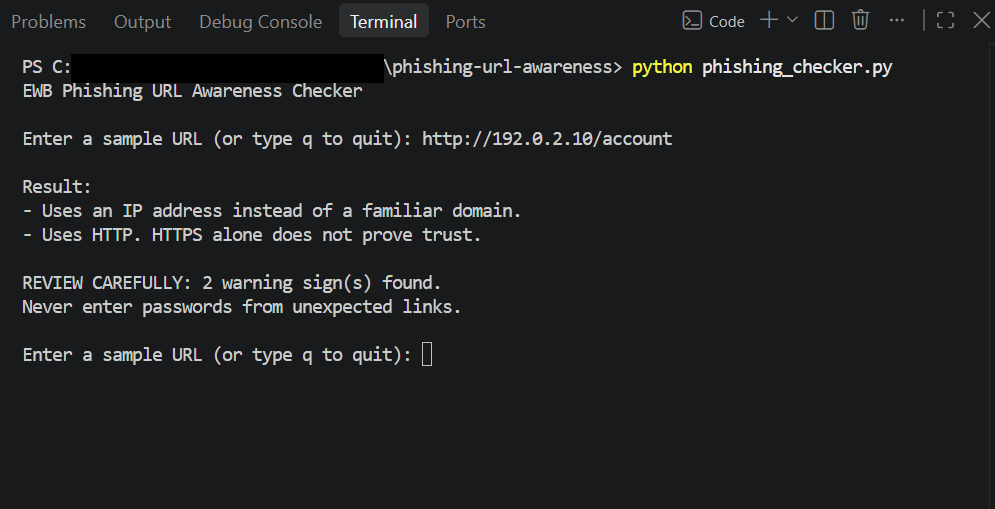
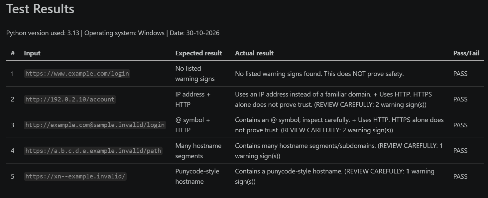

# EWB Phishing URL Awareness Checker

## Overview
Phishing is when someone sends a fake link or message to trick a person into giving their password, card number or OTP. This is a small Python command-line tool that reads the text of a URL and points out a few visible warning signs. It never opens the link, scans a website or sends any data anywhere.

## Features
- Detects an @ symbol in the URL
- Flags unusually long URLs (over 100 characters)
- Flags IP-address hostnames
- Flags many hostname segments (5 or more)
- Flags punycode-style hostnames (xn--)
- Flags the HTTP scheme
- Loop mode: check many URLs in one run, type `q` to quit
- "REVIEW CAREFULLY" summary with the number of warning signs found
- Handles empty and badly formed input without crashing

## Requirements
Python 3.10 or later (tested on Python 3.13, Windows). No extra packages are needed.

## How to Run
Windows:

    python phishing_checker.py

Mac / Linux:

    python3 phishing_checker.py

Run it from a terminal inside the project folder, then type a sample URL when asked.

## Example Output

    EWB Phishing URL Awareness Checker
    Text checks only - this program does not open URLs.

    Enter a sample URL (or type q to quit): http://192.0.2.10/account

    Result:
    - Uses an IP address instead of a familiar domain.
    - Uses HTTP. HTTPS alone does not prove trust.

    REVIEW CAREFULLY: 2 warning sign(s) found.
    Never enter passwords from unexpected links.

## Testing
I ran the five sample URLs from the workbook. All of them gave the result I expected. The full table with the bonus checks is in `tests/test_samples.md`.

| # | Input | Expected | Actual | Result |
|---|-------|----------|--------|--------|
| 1 | https://www.example.com/login | No warning signs | No listed warning signs found | PASS |
| 2 | http://192.0.2.10/account | IP address + HTTP | IP address and HTTP warnings (2) | PASS |
| 3 | http://example.com@sample.invalid/login | @ symbol + HTTP | @ symbol and HTTP warnings (2) | PASS |
| 4 | https://a.b.c.d.e.example.invalid/path | Many hostname segments | Many hostname segments warning (1) | PASS |
| 5 | https://xn--example.invalid/ | Punycode-style hostname | Punycode-style warning (1) | PASS |

One thing I noticed: `https://secure-login.example.invalid` gets no warnings even though the name looks suspicious to a person. So "no warnings" does not mean "safe".

## Screenshots

## Improvements
1. **Loop with quit** - Before, the program closed after one URL. Now it keeps asking until I type `q`, so I can test many URLs quickly. I checked it by running several URLs in one session and then quitting.
2. **Review carefully summary** - When real warnings are found, the program prints how many there are. I added a small function, `has_warnings()`, so info messages like "No URL entered" are not counted as warnings. I re-ran all five tests to check the counts.
3. **Crash fix for bad input** - Typing `http://[bad` used to stop the program with a ValueError. I put the parsing step in a try/except so it now says the text is not a valid URL and keeps running. I tested it with `http://[bad`.

## Limitations
This is an educational tool. It only reads URL text. It does not visit URLs, scan for malware, check reputation services or prove that a URL is safe. No warning signs found does NOT mean a URL is safe. A dangerous link can have none of the six signs, and an honest link can have some.

## Ethical Use
Use sample strings only. Do not collect credentials. Do not use this project to deceive anyone or to test websites without permission.

## AI Use
I used Claude (an AI assistant) to help get started with the code and the documentation. I then ran the program and tests myself, reviewed the code, and edited the project so I can explain how it works.

## Author
Sayyad Sarah Yohan, Cyber Security Internship-Batch 1 , EWB Courses